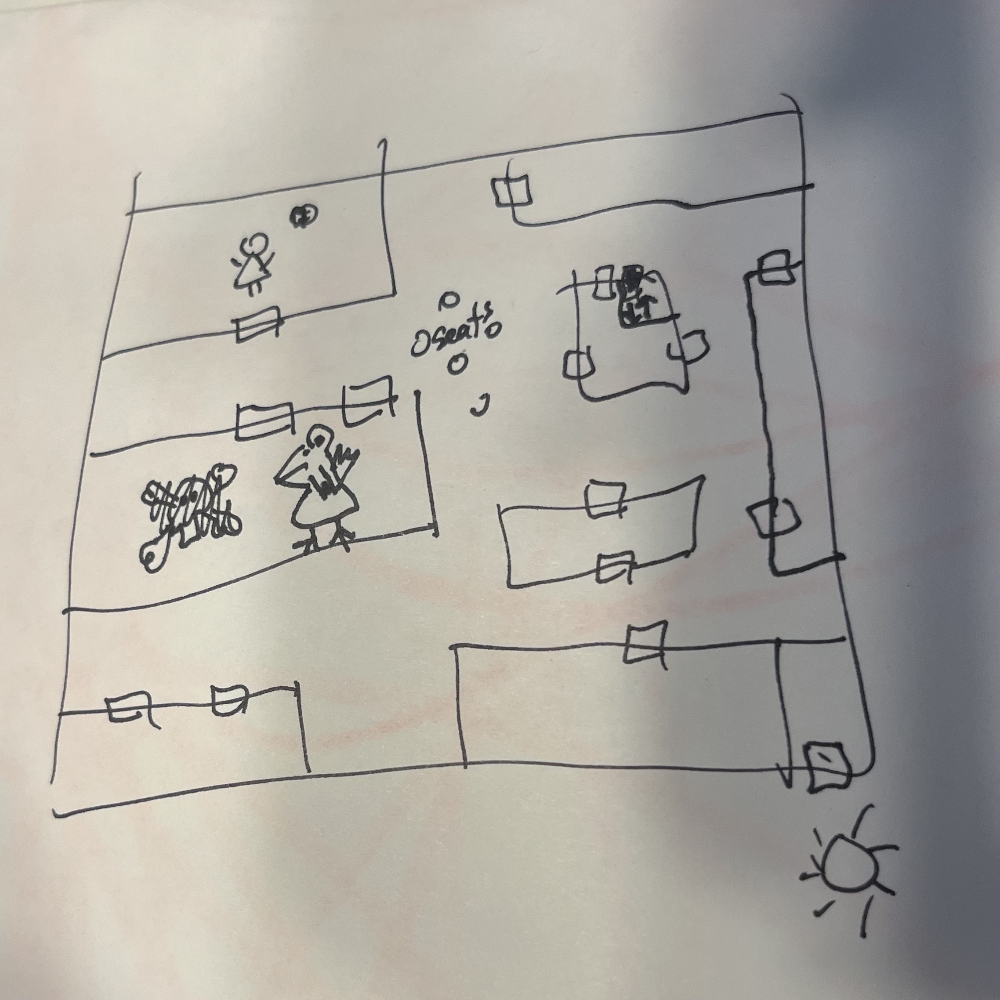

<!-- markdownlint-disable MD041 -->
<!----------------------------------------------------------------------
DISABLE MARKDOWN ERRORS
------------------------------------------------------------------------

MD033 no-inline-html: Inline HTML
MD041 first-line-h1: First line in a file should be a top-level heading
MD045/no-alt-text: Images should have alternate text (alt text)markdownlintMD045
MD060 table-column-style: Table column style [Table pipe does not align with header for style "aligned"]

FORMAT
<!-- markdownlint-disable MD0XX -->

<!--------------------------------------------------------------------->

<!-- markdownlint-disable MD033 -->
<!-- markdownlint-disable MD045 -->

<link rel="stylesheet" href="css/flux-bunny-text-md.css">

# Notes for Gears and Glimmer

This document includes game play notes from DnD sessions.

## House Rules

I can cast ritual cast Speak with Animals.

## Navigation

| Suit         | Value          | Challenge                        | Solved? | Notes                                                        |
| ------------ | -------------- | -------------------------------- | ------- | ------------------------------------------------------------ |
| Hermit       | Minotaur       |                                  | Y       |                                                              |
| Lovers       |                |                                  | Y       |                                                              |
| Major Arcana | Empress        | Fairy Palace                     | Y       | Green glass door riddle                                      |
| Major Arcana | Hierophant     | Temple of Salune                 | N       | Put something silver in fountain, can ask Salune 3 questions |
| Major Arcana | The Lovers     |                                  |         |                                                              |
| Major Arcana | The Hermit     |                                  |         |                                                              |
| Major Arcana | The World      | Tree Tower                       | Y       | Rogl tossed empty wine bottle, killed trees                  |
| Intelligence | 1              | Mouse / tea pot fix              | Y       |                                                              |
| Intelligence | 5              |                                  |         |                                                              |
| Intelligence | 10             |                                  |         |                                                              |
| Intelligence | Knight (12)    |                                  |         |                                                              |
| Wisdom       | 1              | Deer folk with long rest flowers | Y       |                                                              |
| Major Arcana | The Hanged Man | Upside-down lake                 | Y       | Rogl went in with a roped tied                               |

## 2026-09-20 Sun

- Time reset
- Daisy confused, remembers everything but feels like a dream
- Meet up with Fnip, Rogl, Baldus
- Try to save Brambleshade
- Go to court
- Court is in the castle
- Rogl tries to pick the lock of a backdoor
- We go in through the window
- Peak through double doors - banquet style room
- 100 chairs on each side
- No bunny present
- Food and drinks served
- Ask a servant directions to court
- See Brambleshade in court, Rogl eavesdrops
- Brambleshade talking with Corvid (cro bro) and 2 humans
- Brambleshade is concerned, humans trying to reassure him that things look bad but will be ok
- As Corvid and Brambleshade go in different direct directions, Rogl casts sleep on Corvid

Court Drawing

- Corvid ends up in bag of holding
- Fnip gives me sending stone to communicate
- Brambleshade walking into embassy

## 2026-10-10 Sat

| Lvl | Allotment | Used | Spells Used    |
| --- | --------- | ---- | -------------- |
| 1   | 4         |      |                |
| 2   | 3         | 1    | Misty Step     |
| 3   | 3         | 1    | Call Lightning |
| 4   | 1         |      |                |

- I walk into embassy to follow
- 4 foxes brandishing knives at Brambleshade
- They grapple me, I misty step outside
- They throw sleep powder on me, I'm not affected
- I rabbit hop back inside
- Both Brambleshade and I are attacked, hit the ground unconcious
- I am dead

- They fireball the embassy, kill the foxes
- +12 health
- Foxes sent by humans possibly (?)

- Brambleshade goes back to warren
- We go to library in town
- An empty room with doors around room

- "Brownie" librarian - cute drone guy - points to door
- Library is full of drones flying around in hive
- Fnip asks to get all the books on endings
- Drones understand speech but write to communicate

- The missing star is Andromeda
- Finis Mundi - journal called wispy bad guy
- Can ask Salune a question by putting silver in fountain in Heirophant fountain

- Rogl plants a bean, tree grows with 24 fruits
- Rogl eats one - turns into a skunk for 24 hours
- Rogl eats another - for 24 hours deals damage back to those who do damage to him
- Fnip eats one - gets 1 additional divination charge
- I eat one - I turn into an Orc
- Baldus eats one and gets to ask Salune one question:
  - Can you put in a good word about us to your daughter Andromeda that we

- Long rest

---

| Lvl | Allotment | Used | Spells Used |
| --- | --------- | ---- | ----------- |
| 1   | 4         |      |             |
| 2   | 3         |      |             |
| 3   | 3         |      |             |
| 4   | 1         |      |             |

- We go to the Hanged Man

### The Hanged Man 20261010
- See large pool of water / pond
- Surface is still, mirror-like
- I try to skip a rock on the pond
- My reflection is a rabbit, not my orc transformation
- Rogl goes in, we tie him to a rope, he inches in the water, lake is a portal to an upside down world
- We all go through pond portal - back to World

### The World 20261010
- Feels like a place of beginnings, untold stories
- We find the beginnings of stories etched into the walls
- Find a document, the Penumbra Accord
  - Reads like a contract between Humans (Aldenians) & fairies of the forest 300 years ago
  - Written after a conflict, fairies won
  - Truce agreement
  - Fairies have an interest in who is ruling the south side of the river
  - Human ruler must make a pact with fairies
    - Pact
      1. Monthly tithe
      1. Fairies have a say in who rules
      1. No admittance to forest without a visa
      1. Humans can't deforest the southern bank

- We go to

### The Empress 20261010

- Giant Oak tree
  - At base, a green glass door
  - "All may enter who follow the rules
     Barred to many, perhaps even fools
     One at a time and never the same
     Fail to listen, a grave you claim
     Neither knights nor pages may trespass
     But banners and books may enter the glass
     A secret kept is a sacred thing
     What two things would you bring?"

  - I bring grass and a scroll from Fnip

- Garden, with regal looking woman
- She wants the star
- Threatens the warren
- She's worried about Finis Mundi - wispy dude
- I have a feeling of a demand - what is the saddest thing I can think of?
  - Memory from childhood of my brother being dragged off by a fox
  - I shed a tear and feel like I won't be able to cry ever again

- Fairy queen Tatania said she will grant a wish
